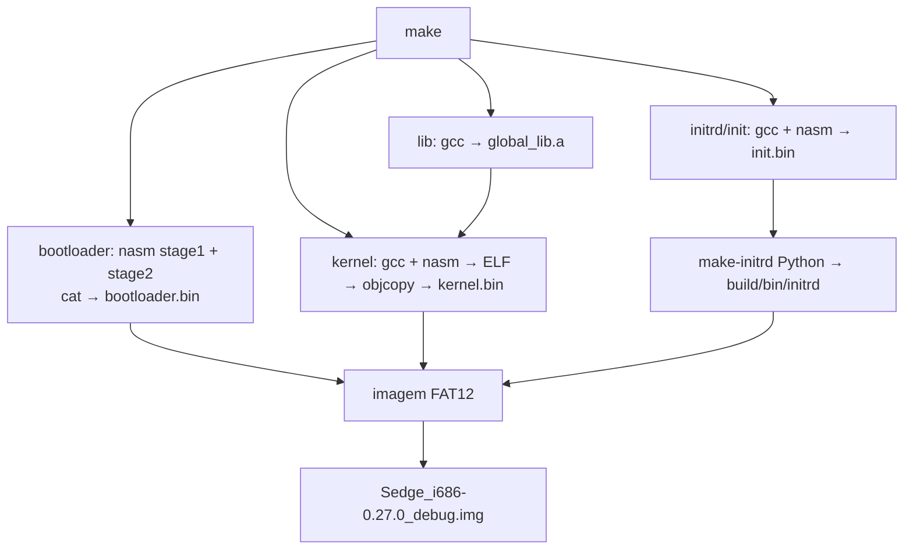

# Build, execução e depuração

> **Arquivos:** [`Makefile`](../Makefile) (raiz), [`kernel/Makefile`](../kernel/Makefile), [`lib/Makefile`](../lib/Makefile), [`initrd/Makefile`](../initrd/Makefile), [`initrd/init/Makefile`](../initrd/init/Makefile), [`bootloader/Makefile`](../bootloader/Makefile) e os Makefiles de `stage1`/`stage2`.

## Requisitos

### Obrigatórios

- NASM
- dosfstools (`mkfs.fat`)
- mtools (`mcopy`)
- compilador cruzado GCC i686-elf (com libgcc) e binutils
- Python 3.11

### Opcionais

- QEMU (`qemu-system-i386`)
- GDB cruzado (`i686-elf-gdb`)

O guia de compilação do compilador cruzado (binutils 2.45, GCC 15.2.0, GDB 17.2) está no [README.md](../README.md#compilador-cruzado). Para executar em hardware real: CPU 386+ e BIOS com extensões INT 13h (EDD).

## Variáveis e artefatos

```make
ARCH     := i686
VERSION  := 0.27.0
NAME     := Sedge
DEBUG    ?= 1
```

| Variável | `DEBUG=1` (padrão) | `DEBUG!=1` |
|---|---|---|
| Imagem | `build/images/Sedge_i686-0.27.0_debug.img` | `build/images/Sedge_i686-0.27.0.img` |
| Bootloader | `build/bin/bootloader_debug.bin` | `build/bin/bootloader.bin` |
| Kernel | `build/bin/kernel_debug.bin` (+ `.elf`) | `build/bin/kernel.bin` (+ `.elf`) |
| Biblioteca | `build/lib/global_lib.a` | idem |
| Initrd | `build/bin/initrd` | idem |

`PROJ`, `NAME`, `VERSION`, `ARCH` e `DEBUG` são exportados para os sub-Makefiles. `DEBUG` **não altera o assembly do bootloader**, apenas as otimizações de C: kernel `-O0 -g` / `-O2`; lib, init e demais `-O0 -g` / `-O1`.

## Fluxo do build



Cada subprojeto é invocado com `FORCE`, portanto recompila sempre. Os arquivos `.d` gerados por `-MD` são incluídos com `-include` (exceto no bootloader, cujo `INCLUDES` está quebrado — veja [limitações](#limitações-conhecidas)).

## Flags de compilação

Base comum (kernel, lib, init):

```make
CFLAGS = -std=c11 -Wall -Wextra \
         -ffreestanding -fno-stack-protector -fno-builtin -nostdlib \
         -nostdinc -fno-omit-frame-pointer -fno-strict-aliasing \
         -fno-pic -fno-pie -fdata-sections -ffunction-sections \
         -mno-sse -mno-sse2 -mno-mmx -mno-3dnow -fmerge-all-constants
```

| Componente | Flags extras |
|---|---|
| Kernel | `-m32`, `-DKERNEL`, `-DNAME=\"Sedge\"`, `-DVERSION=\"0.27.0\"`, includes de `include/`, `kernel/include/`, `kernel/include/arch/i686/`, `include/arch/i686/` |
| Lib | `-m32`, `-DNAME`, `-DVERSION`, include de `include/` |
| Init | `-m32`, sem `-DKERNEL`, mesmas includes do kernel |
| Bootloader | `nasm -f bin -I<srcdir> -DNAME=\"...\" -DVERSION=\"...\"` |
| ASM do kernel/init | `nasm -f elf32` |
| Linkagem | `-T <link.ld> -static -nostdlib -Wl,--gc-sections`, `LDLIBS = -lgcc` |

Outras arquiteturas além de i686/x86_64 geram `$(error Arquitetura nao suportada)`. O build atual é fixado em i686 pelo Makefile raiz.

## Montagem da imagem FAT12

Ordem exata em `$(IMAGE)`:

```bash
mkdir -p build/images build/imgroot
cp build/bin/kernel_debug.bin build/imgroot/kernel.sys
cp build/bin/initrd build/imgroot/initrd
dd if=/dev/zero of=build/images/Sedge_i686-0.27.0_debug.img bs=1K count=1440 status=none
mkfs.fat -F 12 -n SEDGE -R 64 build/images/Sedge_i686-0.27.0_debug.img
mcopy -i <imagem> -s build/imgroot/* ::
dd if=build/bin/bootloader_debug.bin of=<imagem> bs=1 count=3 conv=notrunc
dd if=build/bin/bootloader_debug.bin of=<imagem> bs=1 skip=62 seek=62 count=386 conv=notrunc
dd if=build/bin/bootloader_debug.bin of=<imagem> bs=1 skip=512 seek=512 conv=notrunc
```

O que cada `dd` preserva/injeta:

| Comando | Bytes da imagem | Conteúdo |
|---|---|---|
| `count=3` | 0–2 | `jmp short main` + `nop` do bootloader |
| `skip=62 seek=62 count=386` | 62–447 | código do stage1 a partir de `main` (inclui `dd __TIME__` em 440–443) |
| `skip=512 seek=512` | 512–fim | stage2 inteiro (LBA 1 em diante) |

Os bytes 3–61 (BPB), 448–509 e a assinatura `0xAA55` (510–511) permanecem os do `mkfs.fat`. `-R 64` reserva 64 setores para o bootloader (stage1 + 62 setores do stage2). Detalhes em [bootloader.md](bootloader.md).

## Geração do initrd

O [`initrd/Makefile`](../initrd/Makefile) compila `init.bin` para `initrd/build/root/init.sys` e chama:

```bash
make-initrd build/root build/bin/initrd
```

O script Python [`make-initrd`](../initrd/make-initrd) usa `os.walk` ordenado, escreve `<IIII` no header (magic `0x47554D4D`, versão 1, contagem, `data_offset`), `<IIIII` por entrada (tipo, permissões, tamanho do nome, offset, tamanho), o nome terminado em NUL e os dados **sem padding**. Formato completo em [initrd.md](initrd.md).

## Alvos do Makefile

| Alvo | Ação |
|---|---|
| `all` (padrão) | gera a imagem |
| `bootloader` | monta `bootloader[_debug].bin` |
| `kernel` | compila kernel + ELF com símbolos |
| `global_lib` | compila `build/lib/global_lib.a` |
| `initrd` | gera `build/bin/initrd` |
| `clean` | limpa os quatro subprojetos e remove `build/` |
| `qemu` | executa QEMU com serial via stdio e `tee qemu.log` |
| `qemu-ng` | executa QEMU com `-nographic` |
| `qemu-gdb` | inicia QEMU com `-s -S` e abre `i686-elf-gdb` no `localhost:1234` |

## Execução e depuração

```bash
make            # compila
make qemu       # interface GTK + saída serial redirecionada para qemu.log
make qemu-ng    # sem interface gráfica
make qemu-gdb   # GDB remoto, CPU congelada no início
```

`QEMUFLAGS`:

```make
-drive file=$(IMAGE),format=raw,if=ide,media=disk
-audiodev pipewire,id=audio0
-machine pc,pcspk-audiodev=audio0
-vga std -display gtk
```

`qemu-gdb` carrega `$(KERNEL).elf` (por exemplo `build/bin/kernel_debug.bin.elf`), conecta em `localhost:1234` e **não envia `continue`** — é preciso digitar `c` no GDB. O log de boot gerado por `make qemu` está em `qemu.log` (ignorado pelo Git).

## Suporte a editores

O README descreve um `compile_commands.json` mantido **manualmente** na raiz, com caminhos absolutos e as flags exatas de cada unidade de tradução. O arquivo está no `.gitignore`, **não existe no checkout** e nenhum alvo Make o gera (não há `bear`/`compiledb`). Quem usar `clangd` deve criá-lo/atualizá-lo manualmente ao adicionar fontes ou mover o projeto.

## Limitações conhecidas

1. `DEBUG` não afeta o bootloader; trocar `DEBUG` sem `make clean` pode misturar artefatos debug/release (o `initrd` sempre usa o mesmo caminho).
2. `$(IMAGE)` depende de `$(INIT)`, variável nunca definida no Makefile raiz (expande para vazio).
3. `DEPDIR` é declarado nos sub-Makefiles mas não usado; `INCLUDES` em `stage1`/`stage2` concatena `$(CURDIR)` com um caminho já absoluto e fica vazio (mascarado pelo `FORCE`).
4. `initrd/init/Makefile` depende de `PROJ` exportado pelo Makefile raiz; executá-lo isoladamente procura a biblioteca em `initrd/build/lib/global_lib.a` e falha.
5. `qemu-gdb` não está em `.PHONY`.
6. O README está desatualizado quanto ao nome da imagem (`Sedge-<versão>.img`) e à descrição da imagem como FAT16 — o real é FAT12 com nome `Sedge_i686-<versão>[_debug].img`.

## Ver também

- [Bootloader](bootloader.md)
- [Initrd](initrd.md)
- [Visão geral: mapa de memória](visao-geral.md#mapa-de-memória)
- [Estado atual](estado-atual.md)
