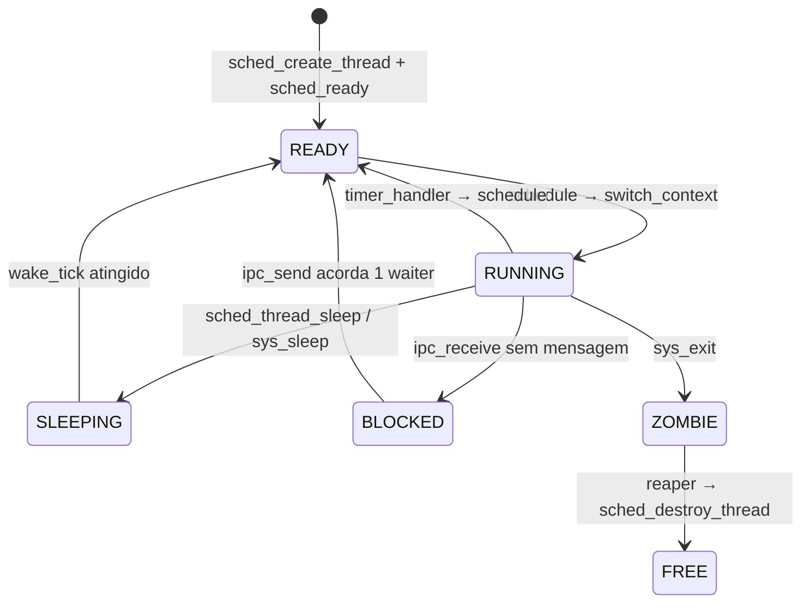

# Escalonador, processos e threads

> **Arquivos:** [`kernel/include/sched/sched.h`](../kernel/include/sched/sched.h), [`kernel/include/sched/process.h`](../kernel/include/sched/process.h), [`kernel/include/sched/thread.h`](../kernel/include/sched/thread.h), [`kernel/include/sched/cap.h`](../kernel/include/sched/cap.h), [`kernel/src/sched/sched.c`](../kernel/src/sched/sched.c), [`kernel/src/sched/process.c`](../kernel/src/sched/process.c), [`kernel/src/sched/thread.c`](../kernel/src/sched/thread.c), troca de contexto em [`kernel/src/arch/i686/idt.asm`](../kernel/src/arch/i686/idt.asm).

## Visão geral

Escalonamento **round-robin sem prioridades**, com quantum igual ao tick do PIT (10 ms a 100 Hz). Cada processo tem até 8 threads, CR3 próprio e uma mailbox de IPC. A troca de contexto é disparada por uma interrupção (timer ou `int $0x81`) e restaura um frame de registradores sintético montado na criação da thread.



## Limites e constantes

```c
#define THREAD_PER_PROCESS 8
#define CAP_PER_PROCESS   16
#define USER_STACK_PAGES  16
#define USER_STACK_TOP    0xBFFFF000
#define KERNEL_STACK_PAGES 1
#define KERNEL_STACK_SIZE  4096
#define USER_STACK_SIZE    65536
```

## Estruturas

```c
typedef struct process {
    mailbox_t mailbox;                    /* ver ipc.md */
    thread_t threads[THREAD_PER_PROCESS];
    cap_t caps[CAP_PER_PROCESS];          /* declaradas, não usadas */
    uint32_t num_threads;
    struct process *prev, *next, *parent;
    uintptr_t cr3;
    process_state_t state;                /* PROCESS_NORMAL | PROCESS_DYING */
    pid_t pid;
} process_t;

typedef struct thread {
    queue_node_t node;                    /* permite enfileirar a thread */
    uintptr_t stack, sp;                  /* pilha de usuário */
    uintptr_t stack0, sp0;                /* pilha de kernel / frame salvo */
    thread_state_t state;
    int32_t exit_code;
    uint32_t wake_tick;
    pid_t pid;
} thread_t;
```

Estados: `THREAD_RUNNING`, `THREAD_READY`, `THREAD_BLOCKED`, `THREAD_ZOMBIE`, `THREAD_SLEEPING`, `THREAD_FREE` (0 = RUNNING, portanto estruturas zeradas em `.bss` já começam "rodando").

Capacidades (`cap.h`): `CAP_MEMORY`, `CAP_IOPORT`, com permissões `P_DELEGATE` e `P_REVOKE`, **ainda não utilizadas**.

## Filas

| Fila | Finalidade | Consumidor |
|---|---|---|
| `ready_queue` | threads prontas para rodar | `schedule()` |
| `sleep_queue` | threads com `wake_tick` | `timer_handler()` |
| `zombie_queue` | threads que saíram | nenhum consumo direto |
| `mailbox.waiters` (por processo) | threads bloqueadas em `ipc_receive` | `ipc_send()` |

Não há `blocked_queue` global. A lista de processos (`first_process`) é duplamente ligada e usa inserção no início (LIFO).

## API

```c
/* sched.h */
int      sched_init(uint16_t frequency);
uint32_t sched_get_ticks(void);
uint32_t sched_get_ms_per_tick(void);

/* process.h */
process_t *sched_create_process(void);
void       sched_destroy_process(process_t *proc);
void       sched_destroy_current_process(void);
pid_t      sched_get_current_pid(void);
pid_t      sched_get_current_ppid(void);
process_t *sched_get_current_process(void);
process_t *sched_get_process(pid_t pid);

/* thread.h */
thread_t *sched_create_thread(uintptr_t loc, pid_t pid);
void      sched_destroy_thread(thread_t *thread);
void      sched_ready(thread_t *thread);
void      sched_zombie(thread_t *thread);
void      sched_sleep(thread_t *thread);
thread_t *sched_get_current_thread(void);
void      sched_exit_current_thread(interrupt_context_t *ctx, int32_t status);
void      sched_thread_sleep(interrupt_context_t *ctx, uint32_t wake_tick);

/* internas (extern) */
void      switch_context(thread_t *new);
void      schedule(interrupt_context_t *ctx);
void      reaper_thread(void);
```

## Inicialização — `sched_init(100)`

1. Frequência `<= 18 Hz` é forçada para 100 Hz; `ms_per_tick = 1000 / frequency` → **10 ms** no boot padrão.
2. Registra `timer_handler` na IDT 32 (`PIC_VECTOR_START + IRQ0`) e configura o PIT em modo onda quadrada.
3. Cria o **processo idle**, PID 0, CR3 = `kernel_cr3`, cuja `threads[0]` é a thread de execução atual (sem pilha própria, estado `RUNNING` por estar em `.bss`).
4. Inicializa as três filas globais e aponta `first_process` para o idle.
5. Registra `schedule` na IDT `0x81` com DPL 3 (`sys_yield`).
6. Cria, via `sys_nthread(reaper_thread)`, a thread reaper no PID 0 (slot `threads[1]`), que acorda a cada 5 s (`sys_sleep(5000)`) para destruir processos `PROCESS_DYING`.
7. `syscall_init()` (chamada logo depois em `kmain`) registra a IDT `0x80` com DPL 3.

Em seguida `kmain` cria o PID 1 (`init`) a partir de `/init.sys` do initrd.

## Troca de contexto

O salvamento não é feito por `switch_context()` diretamente: os stubs da IDT empilham `gs, fs, es, ds, esi, edi, ebp, edx, ecx, ebx, eax`, número da interrupção e código de erro, mais `eip/cs/eflags/esp/ss` pela CPU, formando `interrupt_context_t` (72 bytes).

```c
typedef struct {
    uint32_t gs, fs, es, ds;
    uint32_t esi, edi, ebp, edx, ecx, ebx, eax;
    uint32_t int_num, error_code;
    uint32_t eip, cs, eflags, esp, ss;
} __attribute__((packed)) interrupt_context_t;
```

Sequência de uma troca:

1. `timer_handler(ctx)` ou `schedule(ctx)` grava o ponteiro do frame em `current_thread->sp0`.
2. `schedule()` escolhe a próxima thread da `ready_queue` (round-robin); se for a atual, retorna.
3. `switch_context(new)` atualiza `current_thread`, ajusta `tss_set_sp0(new->stack0 + 4096, 0x10)`, recarrega `write_cr3(proc->cr3)` e chama `restore_context(new->sp0)`.
4. `restore_context()` troca `esp` para o frame salvo e executa `iret` — não retorna.

Para uma thread recém-criada, `sp0 = stack0 + 4096 - 72 = stack0 + 4024`, com um frame sintético: `eip = entry`, `eflags = 0x202`, `cs = 0x1B`/`ds=es=fs=gs=ss=0x23` (usuário) ou `0x08`/`0x10` (kernel).

## Criação de threads e pilhas

`sched_create_thread(loc, pid)` escolhe o primeiro slot livre, aloca 4096 bytes no heap para `stack0` (zerada) e, para processos de usuário, reserva 64 KiB de pilha com uma página-guarda de 4 KiB:

| Slot | `stack` (base) | `sp` (topo) |
|---:|---|---|
| 0 | `0xBFFEF000` | `0xBFFFF000` |
| 1 | `0xBFFDE000` | `0xBFFEE000` |
| 2 | `0xBFFCD000` | `0xBFFDD000` |
| 3 | `0xBFFBC000` | `0xBFFCC000` |
| 4 | `0xBFFAB000` | `0xBFFBB000` |
| 5 | `0xBFF9A000` | `0xBFFAA000` |
| 6 | `0xBFF89000` | `0xBFF99000` |
| 7 | `0xBFF78000` | `0xBFF88000` |

As pilhas são mapeadas no CR3 do processo com `PRESENT | RW | USER`. A criação é usada por `sys_nthread()` e por `sys_nprocess()`.

## Processos

- `sched_create_process()` aloca `process_t` no heap, zera, clona o diretório de páginas com `vmm_clone()`, atribui `pid = current_pid++`, herda o processo atual como `parent`, inicializa a mailbox e insere no início da lista.
- `sched_destroy_process()` reparenta filhos, destrói as 8 threads, chama `vmm_destroy()` + `pmm_free_page(cr3)` e remove o processo da lista.
- O padrão de saída é **marcar `PROCESS_DYING` e deixar o reaper destruí-lo**, porque um processo não pode ser destruído enquanto seu CR3 estiver ativo.

## Sleep, exit e reaper

- `sched_sleep()` desliga interrupções, move o nó da thread para `sleep_queue` e marca `THREAD_SLEEPING`.
- `timer_handler()` compara `ticks >= wake_tick` para cada thread da fila e chama `sched_ready()`, que a move para `ready_queue`.
- `sys_sleep(ms)` converte com `wake_tick = ticks + ms / ms_per_tick` (a 100 Hz, valores < 10 ms não dormem).
- `sched_exit_current_thread(ctx, status)` grava `exit_code`, coloca a thread em `zombie_queue` e chama `schedule()`. **Não há `wait()`/`waitpid()`**: o status nunca é lido.
- `reaper_thread()` varre a lista de processos a cada 5 s e destrói os que estão `PROCESS_DYING`.

## Limitações conhecidas

1. `zombie_queue` nunca é drenada; pilhas e `exit_code` de threads encerradas ficam retidos.
2. Processos cujas threads chamam `SYS_EXIT` não passam para `PROCESS_DYING` — CR3 e páginas vazam.
3. Slots de thread com falha na criação ficam com `state = THREAD_RUNNING` (0) em vez de `THREAD_FREE`.
4. `schedule()` pode deixar a thread atual fora de todas as filas quando ela é o único elemento da `ready_queue`.
5. `schedule()` retorna sem trocar se a fila estiver vazia — não há fallback para uma thread idle escalonável.
6. `tss.esp0` aponta para o topo da pilha kernel, não para o frame; interrupções aninhadas em modo kernel podem sobrescrever o frame salvo.
7. `write_cr3()` é executado mesmo entre threads do mesmo processo (invalidação de TLB desnecessária).
8. Sem prioridades, sem SMP, sem proteção de filas por spinlock (apenas `cli`).
9. `ms_per_tick` é zero para frequências acima de 1000 Hz (divisão por zero em `sys_sleep`).
10. Documentação divergente: o `CHANGELOG.md` afirma que o contexto é salvo em `sp`; o código usa `sp0`.

## Ver também

- [Interrupções e timer](interrupcoes.md) — IDT, PIC, PIT e o frame de registradores
- [Memória](memoria.md) — CR3, `vmm_clone()`, `vmm_destroy()` e heap
- [IPC](ipc.md) — bloqueio de threads em mailboxes
- [Syscalls](syscalls.md) — `sys_nprocess`, `sys_nthread`, `sys_sleep`, `sys_exit`, `sys_yield`
- [Initrd](initrd.md) — de onde vem a imagem do PID 1
