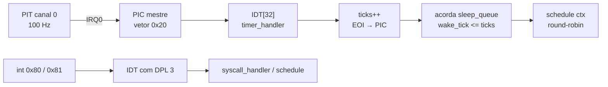

# Interrupções, PIC e PIT

> **Arquivos:** [`kernel/src/pic.c`](../kernel/src/pic.c), [`kernel/include/pic.h`](../kernel/include/pic.h), [`kernel/src/pit.c`](../kernel/src/pit.c), [`kernel/include/pit.h`](../kernel/include/pit.h), integração em [`kernel/src/sched/sched.c`](../kernel/src/sched/sched.c) e [`kernel/src/arch/i686/idt.c`](../kernel/src/arch/i686/idt.c).

## Visão geral

As interrupções do Sedge são roteadas pela IDT ([arquitetura-i686.md](arquitetura-i686.md#idt-e-tratadores)). As exceções 0–31 são tratadas por `exception_handler`; as IRQs do PIC são remapeadas para 0x20–0x2F. Apenas IRQ0 (timer) é usada e desmascarada. O vetor `0x80` atende syscalls e o `0x81` é o yield do escalonador.



## PIC

```c
#define PIC_VECTOR_START 0x20

void pic_remap(void);
void pic_send_eoi(uint8_t irq);
void pic_irq_set_mask(uint8_t irq);
void pic_irq_clear_mask(uint8_t irq);
```

`pic_remap()` envia a sequência de ICWs para os dois PICs (portas `0x20/0x21` e `0xA0/0xA1`), com `io_wait()` após cada escrita:

| Ordem | Porta | Valor | Finalidade |
|---:|---:|---:|---|
| 1–2 | `0x20`, `0xA0` | `0x11` | ICW1: inicialização com ICW4 |
| 3–4 | `0x21`, `0xA1` | `0x20`, `0x28` | offsets de vetor: mestre 0x20, escravo 0x28 |
| 5–6 | `0x21`, `0xA1` | `0x04`, `0x02` | cascata na IRQ2 / identidade do escravo |
| 7–8 | `0x21`, `0xA1` | `0x01`, `0x01` | ICW4 modo 8086 |
| 9–10 | `0x21`, `0xA1` | `0xFF`, `0xFF` | todas as IRQs mascaradas |

Mapeamento resultante: IRQ0–7 → `0x20–0x27`; IRQ8–15 → `0x28–0x2F`. `pic_send_eoi(irq)` envia `0x20` ao PIC escravo quando `irq >= 8` e sempre ao mestre. `pic_irq_set_mask/clear_mask` operam o bit `irq` (ou `irq-8`) na porta de dados correspondente.

> IRQ1 (teclado, vetor `0x21`) permanece mascarada e **não há handler registrado** — o Sedge ainda não possui driver de teclado.

## PIT

```c
#define PIT_BASE_FREQUENCY 1193182
#define PIT_CMD            0x43
#define PIT0 0
#define PIT1 1
#define PIT2 2
#define PIT_RATE_GENERATOR        0b00000100   /* modo 2 */
#define PIT_SQUARE_WAVE_GENERATOR 0b00000110   /* modo 3 */

void pit_set_frequency(uint16_t channel, uint16_t frequency, uint8_t mode);
```

Funcionamento:

1. Rejeita canal > 2 ou frequência zero.
2. `divisor = 1193182 / frequency`; rejeita 0 ou > `0xFFFF`.
3. Para o canal 0, chama `pic_irq_clear_mask(0)`.
4. `command = (channel << 6) | 0b00110000 | (mode & 0b00001110)`: acesso lobyte/hibyte + modo.
5. Escreve `command` em `0x43` e o divisor (baixo, alto) na porta `0x40 + channel`.
6. Para o canal 0, chama `pic_irq_clear_mask(0)` novamente (redundante).

Configuração usada por `sched_init(100)`:

| Parâmetro | Valor |
|---|---|
| Canal / modo | PIT0, onda quadrada (modo 3) |
| Byte de comando | `0x36` |
| Frequência | 100 Hz |
| Divisor | `1193182 / 100 = 11931 = 0x2E9B` (bytes `0x9B`, `0x2E`) |
| `ms_per_tick` | `1000 / 100 = 10` |

Frequências `<= 18 Hz` passadas a `sched_init()` são forçadas para 100 Hz.

## Timer handler

`timer_handler()` é estático em `sched.c` e registrado na IDT 32:

```c
static void timer_handler(interrupt_context_t *ctx) {
    ticks++;
    pic_send_eoi(0);
    /* para cada thread em sleep_queue com ticks >= wake_tick: sched_ready(t) */
    schedule(ctx);
}
```

- O EOI é enviado **antes** do escalonamento.
- `wake_tick` é calculado em `sys_sleep_impl()` como `ticks + ms / ms_per_tick` (a 100 Hz, `sys_sleep(5000)` ⇒ 500 ticks ⇒ 5 s; valores < 10 ms não dormem).
- `schedule(ctx)` grava o frame em `current_thread->sp0`, escolhe a próxima thread `READY` e chama `switch_context()`, que não retorna.
- O reaper do PID 0 usa `sys_sleep(5000)` para acordar a cada 5 s e destruir processos `PROCESS_DYING`.

## Syscalls e yield pela IDT

| Vetor | Handler | DPL | Finalidade |
|---:|---|---:|---|
| `0x80` | `syscall_handler` | 3 | chamadas de sistema (`SYS_EXIT`…`SYS_UNMAP`) |
| `0x81` | `schedule` | 3 | cedência voluntária (`sys_yield()`) |

`syscall_init()` registra `0x80` com `idt_set_dpl(0x80, 3)`; `sched_init()` faz o mesmo por `0x81`. Ambos são acessíveis a partir do ring 3. Ao retornar, o handler de syscall sobrescreve `ctx->eax` com o valor de retorno antes do `iret`. Veja [syscalls.md](syscalls.md).

## Limitações conhecidas

1. IRQ1 e todas as outras IRQs (exceto IRQ0) ficam mascaradas após `pic_remap()` — sem teclado, sem disco, sem serial por interrupção.
2. `serial_init()` habilita IRQs na UART, mas elas não são desmascaradas no PIC; se um dia forem, não há handler.
3. `pit_set_frequency()` desmascara IRQ0 duas vezes; o divisor é truncado, com pequena deriva em relação a 100 Hz.
4. `ms_per_tick` é zero para frequências acima de 1000 Hz (divisão por zero em `sys_sleep`); valores abaixo de 10 ms viram zero ticks.
5. `schedule()` retorna sem trocar se a fila de prontas estiver vazia e pode deixar a thread atual fora das filas em alguns caminhos ([escalonador.md](escalonador.md#limitações-conhecidas)).
6. Não há tratamento de *spurious IRQ*, nem proteção contra interrupções aninhadas em modo kernel (o `esp0` da TSS aponta para o topo da pilha, não para o frame salvo).

## Ver também

- [Arquitetura i686: IDT e stubs](arquitetura-i686.md#idt-e-tratadores)
- [Escalonador](escalonador.md)
- [Syscalls](syscalls.md)
- [Saída e debug](saida-e-debug.md)
