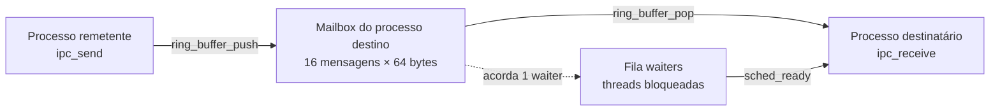

# IPC — Comunicação entre processos

> **Status:** implementado e funcional, com limitações importantes de concorrência e validação.
> **Arquivos:** [`kernel/include/ipc.h`](../kernel/include/ipc.h), [`kernel/src/ipc.c`](../kernel/src/ipc.c), inicialização da mailbox em [`kernel/src/sched/process.c`](../kernel/src/sched/process.c), syscalls em [`kernel/src/arch/i686/syscall.c`](../kernel/src/arch/i686/syscall.c).

## Visão geral

O Sedge usa **mailboxes por processo** (não por thread) com um *ring buffer* de mensagens e uma fila de threads esperando. `ipc_send()` deposita uma mensagem na mailbox do processo destinatário e acorda **uma** thread bloqueada. `ipc_receive()` consome a mensagem mais antiga da mailbox do processo atual; se não houver mensagem, a thread é bloqueada e cedida ao escalonador.



## Constantes

```c
#define IPC_QUEUE_SIZE 16
#define IPC_MSG_MAX    64
```

## Estruturas

```c
typedef struct ipc_message {
    uint32_t sender_pid;          /* PID de quem enviou */
    uint32_t type;                /* tipo definido pela aplicação */
    uint32_t size;                /* bytes válidos em data */
    uint8_t  data[IPC_MSG_MAX];   /* até 64 bytes */
} ipc_message_t;

typedef struct mailbox {
    ipc_message_t data[IPC_QUEUE_SIZE];
    ring_buffer_t ring_buffer;
    queue_t       waiters;
} mailbox_t;
```

A mailbox faz parte de `process_t` ([`process.h`](../kernel/include/sched/process.h)) e é inicializada em `sched_create_process()`:

```c
ring_buffer_init(&proc->mailbox.ring_buffer, (void *)proc->mailbox.data,
                 sizeof(ipc_message_t), IPC_QUEUE_SIZE);
queue_init(&proc->mailbox.waiters);
```

Em i386 cada mensagem ocupa 76 bytes e a mailbox cerca de 1,2 KiB, todos dentro da estrutura do processo (que é alocada no heap do kernel).

## API

```c
int ipc_send(uint32_t pid, uint32_t type, const void *data, uint32_t size);
int ipc_receive(uint32_t *sender_pid, void *buffer, uint32_t size);
```

### `ipc_send(pid, type, data, size)`

| Etapa | Comportamento |
|---|---|
| Validação | `data != NULL`, `size > 0`, `size <= IPC_MSG_MAX` |
| Destino | `sched_get_process(pid)`; falha se inexistente ou `PROCESS_DYING` |
| Mensagem | `memcpy(msg.data, data, size)`, preenche `sender_pid` com `sched_get_current_pid()` e `type` |
| Enfileiramento | `ring_buffer_push(&p->mailbox.ring_buffer, &msg)`; retorna `1` se a fila estiver cheia |
| Despertar | se `waiters` não estiver vazia: `queue_pop()` → `CONTAINER_OF(n, thread_t, node)` → `sched_ready(t)` |
| Retorno | `0` = enviado, `1` = erro/fila cheia |

### `ipc_receive(sender_pid, buffer, size)`

| Etapa | Comportamento |
|---|---|
| Validação | `sender_pid != NULL`, `buffer != NULL`, `0 < size <= 64` |
| Mensagem disponível | `ring_buffer_pop()`, grava `*sender_pid`, copia `MIN(size, msg.size)` bytes, retorna `0` |
| Sem mensagem | desliga interrupções, marca a thread atual como `THREAD_BLOCKED`, remove seu nó da fila atual e o coloca em `mailbox.waiters`, restaura flags e chama `sys_yield()` (`int $0x81`) |
| Após o despertar | consome a mensagem da mesma forma; **não há novo cheque de disponibilidade** |

> O comentário original do header resume: *"Por enquanto, sempre bloqueia a thread que está esperando"*. Não existe receive não-bloqueante, timeout nem filtro por `type`.

## Syscalls correspondentes

Definidas em [`include/arch/i686/syscall.h`](../include/arch/i686/syscall.h):

| Syscall | Nº | Registradores de entrada |
|---|---:|---|
| `SYS_SEND` | 6 | `eax=6`, `ebx=pid`, `ecx=type`, `esi=data`, `edx=size` |
| `SYS_RECEIVE` | 7 | `eax=7`, `esi=sender_pid`, `edi=buffer`, `ebx=size` |

Wrappers de usuário:

```c
int sys_send(uint32_t pid, uint32_t type, const void *data, size_t size);
int sys_receive(uint32_t *sender_pid, void *buffer, size_t size);
void sys_yield(void);   /* int $0x81 — não é uma syscall 0x80 */
```

Os handlers no kernel apenas desempacotam `interrupt_context_t` e chamam `ipc_send()`/`ipc_receive()`. Veja [syscalls.md](syscalls.md) para a convenção completa.

## Limitações conhecidas

1. **Condições de corrida:** nem o ring buffer nem a fila `waiters` são protegidos por spinlock/`cli` nas funções de IPC (ao contrário de `sched_ready()` e `sched_sleep()`).
2. **Race after wake:** após `sys_yield()` a thread não verifica se a mensagem continua na fila; outro consumidor pode tê-la retirado.
3. **Interrupções reabilitadas antes do `sys_yield()`**: um tick do timer pode escalonar antes da própria syscall de yield.
4. **Type e tamanho reais não são devolvidos** ao receptor; mensagens maiores que `size` são silenciosamente truncadas (`MIN`).
5. **Apenas um waiter é acordado** por mensagem, mesmo com várias threads bloqueadas.
6. **Sem validação de ponteiros de usuário** — `copy_from_user`/`copy_to_user` e `is_in_user_range` estão pendentes em [`TODO.md`](../TODO.md).
7. `ring_buffer_t` e `queue_t` são reutilizados diretamente; veja [biblioteca.md](biblioteca.md) para suas semânticas.

## Ver também

- [Escalonador e threads](escalonador.md) — estados `THREAD_BLOCKED`, filas e `sched_ready()`
- [Syscalls](syscalls.md) — convenção `int $0x80`
- [Estado atual e pendências](estado-atual.md) — lista consolidada de limitações
