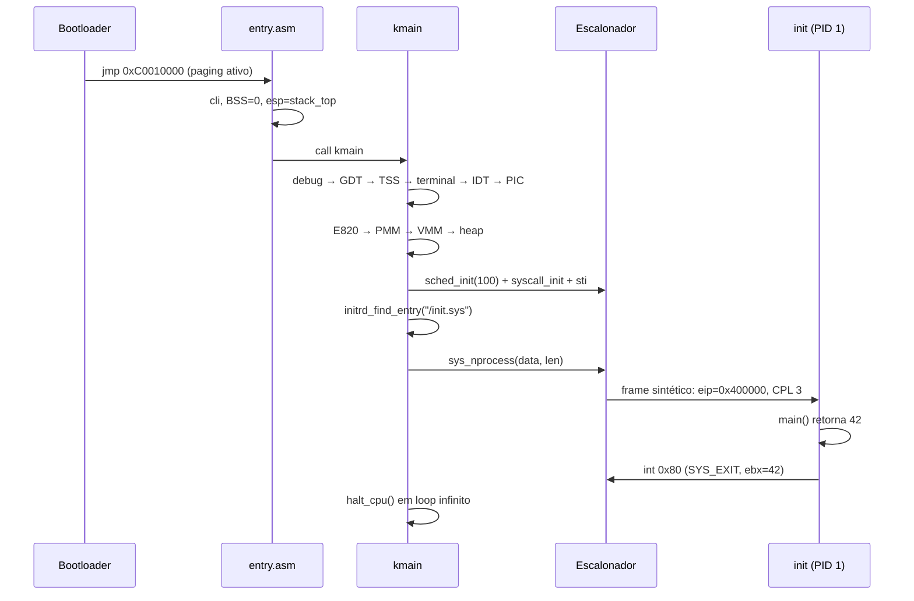

# Kernel — estrutura e inicialização

> **Arquivo principal:** [`kernel/src/kmain.c`](../kernel/src/kmain.c).
> **Documentação relacionada:** [visão geral](visao-geral.md), [arquitetura i686](arquitetura-i686.md), [saída e debug](saida-e-debug.md).

## Organização do código

| Diretório / arquivo | Responsabilidade |
|---|---|
| `kernel/src/kmain.c` | ponto de entrada C; sequência de inicialização e launch do `init` |
| `kernel/src/arch/i686/entry.asm` | `_start`: `cli`, BSS, pilha estática, `call kmain` |
| `kernel/src/arch/i686/link.ld` | VMA `0xC0010000`, seções alinhadas em 4 KiB |
| `kernel/src/arch/i686/` | GDT, IDT, TSS, exceções, E820, PMM, VMM, syscalls, I/O |
| `kernel/src/sched/` | escalonador, processos, threads, reaper |
| `kernel/src/heap.c` | alocador first-fit do heap do kernel |
| `kernel/src/vfs.c`, `ipc.c` | VFS e IPC |
| `kernel/src/debug.c`, `serial.c`, `terminal.c`, `vga.c` | saída e depuração |
| `kernel/src/pic.c`, `pit.c` | controladores de interrupção e timer |
| `kernel/include/` | headers internos do kernel |

O kernel é compilado como ELF32 (`kernel_debug.bin.elf`), convertido com `objcopy -O binary` em `kernel.sys` dentro da imagem FAT12. `entry.asm` define a pilha inicial de 4096 bytes em `.bss` e zera `__bss_start..__bss_end` antes de chamar `kmain()`. Não recebe argumentos nem parâmetros de boot: toda a comunicação com o bootloader é por endereços fixos ([bootloader.md](bootloader.md#interface-com-o-kernel)).

## Constantes globais em `kmain.c`

```c
const char *initpath = "/init.sys";
uintptr_t initrd_loc = 0xC0050000;   /* alias virtual de 0x50000 */
```

## Sequência de inicialização de `kmain`

`kmain()` começa com `disable_interrupts()` e termina em um loop de `hlt`. A ordem é crítica: cada subsistema depende do anterior.

| # | Chamada | Efeito / mensagem principal |
|---:|---|---|
| 1 | `disable_interrupts()` | `cli` (o `entry.asm` já havia desligado) |
| 2 | `debug_init()` | `serial_init(COM1, 9600)`; falha avisa apenas pela serial |
| 3 | `gdt_init()` | GDT com 8 entradas, segmentos kernel e usuário |
| 4 | `tss_init()` | TSS na entrada 5 (`0x28`), `ss0 = 0x10` |
| 5 | `terminal_init()` | limpa o console VGA 80×25, cor `0x07` |
| 6 | `idt_init()` | 256 vetores, gates DPL 0 |
| 7 | `pic_remap()` | IRQs remapeadas para `0x20..0x2F`, todas mascaradas |
| 8 | `exception_init()` | registra tratadores 0..31 |
| 9 | `E820_init()` | imprime `e820[i]: 0xBASE-0xFIM: tipo` |
| 10 | `pmm_init()` | bitmap de páginas físicas; `Memoria utilizavel: 0x...` |
| 11 | `vmm_init()` | salva `kernel_cr3`, remove identidade do 1º MiB; `CR3 do kernel: 0x...` |
| 12 | `heap_init()` | 24 páginas em `0xE0000000` (96 KiB) |
| 13 | `sched_init(100)` | PID 0 (idle), PIT 100 Hz, `0x81`, thread reaper |
| 14 | `syscall_init()` | handler `0x80` com DPL 3 |
| 15 | `enable_interrupts()` | `sti` — o timer começa a escalonar |
| 16 | `initrd_create(&initrd, (void *)initrd_loc)` | monta o parser sobre `0xC0050000` |
| 17 | `initrd_check()` | valida magic; falha → `Falha ao carregar initrd!` |
| 18 | `initrd_find_entry(&initrd, "/init.sys")` | falha → `Falha ao carregar init!` + `Entrada no initrd: '/init.sys'` |
| 19 | `initrd_get_len()` / `printk()` | `Encontrado '/init.sys'` e `Tamanho: N b` |
| 20 | `sys_nprocess(data, len)` | cria PID 1 com imagem em `0x400000`, thread em ring 3 |
| 21 | `for (;;) halt_cpu();` | loop final de parada |

Se `sched_init()` ou a leitura do initrd falhar, o fluxo vai para o rótulo `halt`: imprime `Sistema parado\r\n`, desliga interrupções e executa `hlt`. Se `kmain()` retornar, `_start` entra em `.hang: cli; hlt; jmp .hang`.



## Estado após a inicialização

| Entidade | Estado |
|---|---|
| Processo 0 (`idle_process`) | `cr3 = kernel_cr3`, `threads[0]` em execução |
| Thread reaper | PID 0, slot `threads[1]`, `sys_sleep(5000)` em loop |
| Processo 1 (`init`) | `cr3` clonado, imagem em `0x400000`, 1 thread em `THREAD_READY` |
| IRQs | apenas IRQ0 desmascarada; IRQ1 (teclado) mascarada |
| Syscalls | `0x80` (DPL 3) e `0x81` (yield, DPL 3) |
| VFS | nenhum filesystem registrado/montado |
| IPC | mailbox inicializada em cada processo |

## Mensagens de boot (ordem)

```text
Inicializando escalonador...
Processo idle criado com PID 0
Criando thread no processo PID 0, entry=...
Thread criada com sucesso (PID 0)
Escalonador inicializado
e820[0]: 0x0000000000000000-0x...: 1
...
Memoria utilizavel: 0x...
CR3 do kernel: 0x...
Criando processo...
Processo criado com PID 1
Criando thread no processo PID 1, entry=0x400000
Thread criada com sucesso (PID 1)
Encontrado '/init.sys'
Tamanho: N b
```

Todas passam por `printk()` e aparecem **duplicadas** no console e na serial ([saida-e-debug.md](saida-e-debug.md)).

## Observações

- Não há testes de demonstração de heap, VFS, IPC ou exceções em `kmain` (o teste de divisão por zero foi removido na v0.23.0).
- O esqueleto de RAMFS vive em `kmain.c` (`ramfs_init`, `ramfs_open`, `ramfs_close`), mas `ramfs_init()` nunca é chamada e o código está incompleto — veja [vfs.md](vfs.md#ramfs-em-andamento).
- `kmain` é `void kmain(void)`: o bootloader não passa nenhum argumento por registrador.
