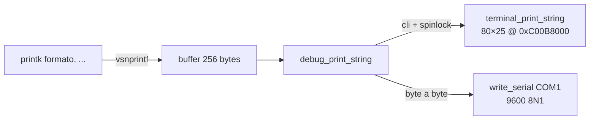

# Saída de texto e depuração

> **Arquivos:** [`kernel/include/debug.h`](../kernel/include/debug.h), [`kernel/src/debug.c`](../kernel/src/debug.c), [`kernel/include/terminal.h`](../kernel/include/terminal.h), [`kernel/src/terminal.c`](../kernel/src/terminal.c), [`kernel/include/vga.h`](../kernel/include/vga.h), [`kernel/src/vga.c`](../kernel/src/vga.c), [`kernel/include/serial.h`](../kernel/include/serial.h), [`kernel/src/serial.c`](../kernel/src/serial.c).

## Visão geral

Toda mensagem do kernel passa por `printk()`, que formata o texto em um buffer de 256 bytes e o envia **duplicado** para o terminal VGA e para a porta serial COM1. Não há níveis de log; a serial é o canal de depuração usado por `make qemu` (`tee qemu.log`).



## Debug

```c
void debug_init(void);
void debug_print_string(const char *s);
void debug_log_string(const char *section, const char *s); /* declarada, não implementada */
int  printk(const char *format, ...);
void debug_dump_code(uintptr_t eip, uint32_t count);
```

- `debug_init()` chama `serial_init(COM1, 9600)`. É a primeira chamada de `kmain()`, **antes** de `terminal_init()`: mensagens de falha não aparecem no terminal (a serial é o único destino possível).
- `debug_print_string()` desliga interrupções (`read_flags()` + `disable_interrupts()`), toma `debug_lock` (spinlock), envia a string ao terminal e à serial byte a byte, libera o lock e restaura as flags.
- `printk()` usa `vsnprintf()` ([biblioteca.md](biblioteca.md)) com buffer fixo de 256 bytes. Retorna o tamanho **lógico** da formatação, que pode ultrapassar 255 quando há truncamento.
- `debug_dump_code(eip, count)` imprime `Bytes em 0x%016llX: ` seguido de `count` bytes em hexadecimal maiúsculo (`%02hhX`). O handler de exceções chama com `count = 16`.

Formatos suportados: `%c`, `%s`, `%p` (prefixo `0x`), `%d`, `%i`, `%u`, `%x`, `%X`, `%o`, `%%`, com modificadores `h`, `hh`, `l`, `ll`, flag `0` e largura decimal. String `NULL` vira `(null)`.

## Terminal VGA

| Constante | Valor |
|---|---|
| `TERMINAL_WIDTH` / `TERMINAL_HEIGHT` | 80 / 25 |
| Cor padrão | `0x07` (cinza-claro sobre preto) |
| Endereço virtual usado | `0xC00B8000` (= `0xC0000000 + 0xB8000`) |
| Célula | `uint8_t ch; uint8_t attr;` (2 bytes, `packed`) |

```c
void terminal_init(void);
void terminal_putchar(char c);
void terminal_print_string(const char *s);
void terminal_scroll_up(void);   /* interna, não declarada no header */
```

- `terminal_init()` zera o cursor, preenche as 2000 células com `' '`/`0x07`, posiciona o cursor e marca `initialized = 1`.
- `terminal_putchar()` trata `'\n'` (linha abaixo), `'\r'` (retorno ao início) e caracteres imprimíveis; ao passar da coluna 79 quebra linha e ao passar da linha 24 chama `terminal_scroll_up()`, que desloca todas as linhas uma posição para cima e limpa a última.
- `vga_draw_cell()`, `vga_peek_cell()` e `vga_update_cursor()` acessam diretamente o buffer; o cursor é atualizado nos registradores `0x0F`/`0x0E` da porta `0x3D4`.

## Serial

```c
#define COM1 0x3F8
#define COM2 0x2F8
#define COM3 0x3E8
#define COM4 0x2E8

int  serial_init(uint16_t port, int baudrate);  /* 0 = ok, 1 = falha */
void write_serial(uint16_t port, char a);
```

Inicialização: DLAB (`port+3 = 0x80`), divisor `115200 / baudrate` (12 = `0x000C` para 9600), 8N1 (`port+3 = 0x03`), FIFO (`port+2 = 0xC7`), habilitação de IRQs (`port+4 = 0x0B`), teste de loopback com `0xAE` e volta ao modo normal (`port+4 = 0x0F`).

`write_serial()` faz *busy-wait* até o bit 5 do LSR (`port+5`) indicar *transmit holding register empty* e então escreve em `port`. As IRQs da UART são habilitadas no chip, mas ficam mascaradas no PIC ([interrupcoes.md](interrupcoes.md)).

## Limitações

1. Cor fixa em `0x07`: não há API pública para trocar atributo de cor.
2. `vga_draw_cell()`/`vga_peek_cell()` não validam limites — coordenadas fora de 80×25 escrevem em memória adjacente.
3. Não há suporte a tabulação, backspace ou sequências ANSI; caracteres de controle são desenhados literalmente.
4. Constantes de dimensão duplicadas entre `terminal.h` e `vga.c`.
5. `debug_log_string()` é declarada, mas não implementada; não existem níveis de log.
6. `debug_dump_code()` chama `printk()` uma vez por byte (17 aquisições de lock para 16 bytes) e lê `eip` sem validar mapeamento. A macro `BYTE_TO_HEX()` de `kernel/include/utils.h` existe, mas não é usada por essa função.
7. `printk()` trunca em 255 caracteres, mas o retorno reflete o tamanho não truncado.
8. `serial_init()` escreve `outb(port+4, 0x0F)` duas vezes e habilita IRQs sem handler instalado.
9. `debug_init()` roda antes de `terminal_init()`, então falhas na serial não são visíveis no console.

## Ver também

- [Sequência de boot](kernel.md#sequência-de-inicialização-de-kmain) — quando cada subsistema é iniciado
- [Biblioteca comum](biblioteca.md) — `vsnprintf`, spinlock e funções de string
- [Exceções](arquitetura-i686.md#exceções) — uso de `debug_dump_code()`
