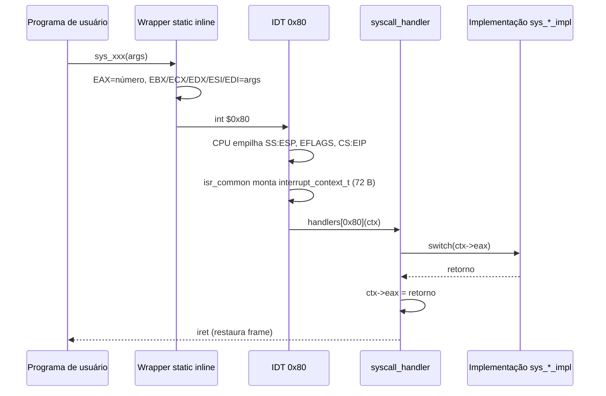

# Syscalls

> **Arquivos:** [`include/arch/i686/syscall.h`](../include/arch/i686/syscall.h) (API de usuário, `static inline`), [`kernel/src/arch/i686/syscall.c`](../kernel/src/arch/i686/syscall.c) (dispatch e implementações), [`kernel/include/arch/i686/idt.h`](../kernel/include/arch/i686/idt.h) (contexto de interrupção).

## Visão geral

Chamadas de sistema usam `int $0x80`, com o número da syscall em `EAX` e o retorno sobrescrito no próprio `EAX`. O vetor é uma *interrupt gate* com **DPL 3**, acessível a partir do ring 3. Um segundo vetor, `int $0x81` (também DPL 3), não é uma syscall: é o ponto de entrada direto do escalonador (`sys_yield()`).



## Números e convenção

```c
enum {
    SYS_EXIT     = 0,
    SYS_GETPID,      /* 1 */
    SYS_GETPPID,     /* 2 */
    SYS_NPROCESS,    /* 3 */
    SYS_NTHREAD,     /* 4 */
    SYS_SLEEP,       /* 5 */
    SYS_SEND,        /* 6 */
    SYS_RECEIVE,     /* 7 */
    SYS_MAP,         /* 8 */
    SYS_UNMAP,       /* 9 */
};
```

| Syscall | Nº | Wrapper | Registradores de entrada | Handler no kernel | Retorno |
|---|---:|---|---|---|---|
| `SYS_EXIT` | 0 | `void sys_exit(int status)` | `eax=0`, `ebx=status` | `sys_exit_impl` → `sched_exit_current_thread(ctx, status)` | — |
| `SYS_GETPID` | 1 | `uint32_t sys_getpid(void)` | `eax=1` | `sys_getpid_impl` → `sched_get_current_pid()` | PID |
| `SYS_GETPPID` | 2 | `uint32_t sys_getppid(void)` | `eax=2` | `sys_getppid_impl` → `sched_get_current_ppid()` | PID do pai (0 se idle) |
| `SYS_NPROCESS` | 3 | `uint32_t sys_nprocess(const void *entry, uint32_t n)` | `eax=3`, `ebx=entry`, `ecx=n` | `sys_nprocess_impl` | PID do novo processo |
| `SYS_NTHREAD` | 4 | `int sys_nthread(void (*entry)(void))` | `eax=4`, `ebx=entry` | `sys_nthread_impl` → `sched_create_thread` + `sched_ready` | 0 ou `-1` |
| `SYS_SLEEP` | 5 | `void sys_sleep(uint32_t ms)` | `eax=5`, `ebx=ms` | `sys_sleep_impl` → `sched_thread_sleep` | — |
| `SYS_SEND` | 6 | `int sys_send(uint32_t pid, uint32_t type, const void *data, size_t size)` | `eax=6`, `ebx=pid`, `ecx=type`, `esi=data`, `edx=size` | `sys_send_impl` → `ipc_send()` | 0 = ok |
| `SYS_RECEIVE` | 7 | `int sys_receive(uint32_t *sender_pid, void *buffer, size_t size)` | `eax=7`, `esi=sender_pid`, `edi=buffer`, `ebx=size` | `sys_receive_impl` → `ipc_receive()` | 0 = ok |
| `SYS_MAP` | 8 | `int sys_map(uintptr_t phys, uintptr_t virt, uint32_t pages, uint32_t flags)` | `eax=8`, `esi=phys`, `edi=virt`, `ebx=pages`, `edx=flags` | **não despachado** (stub) | `-1` |
| `SYS_UNMAP` | 9 | `void sys_unmap(uintptr_t virt, uint32_t pages)` | `eax=9`, `edi=virt`, `ebx=pages` | **não despachado** (stub) | `-1` |

Resumo da convenção: `EAX` = número/retorno, `EBX` = 1º argumento, `ECX` = 2º, `EDX` = tamanho/flags, `ESI`/`EDI` = ponteiros (restrições GCC `"S"`/`"D"`). `sys_send` e `sys_receive` usam posições diferentes para o tamanho (`EDX` vs `EBX`).

### yield (`int 0x81`)

```c
void sys_yield(void);   /* int $0x81, sem operandos */
```

Registrado em `sched_init()` como `idt_set_handler(0x81, schedule)` com DPL 3. É usado pelo reaper, por `ipc_receive()` quando bloqueia e por `sched_destroy_current_process()`.

## Syscalls em detalhe

### `sys_nprocess(data, n)`

Usada pelo kernel para lançar o `init`:

1. Valida chamador de usuário: `0x400000 <= entry < 0xC0000000`, `n <= 16 MiB`, sem overflow de `entry + n`.
2. Copia `n` bytes da imagem para o heap do kernel.
3. `sched_create_process()` → `vmm_clone()` (novo CR3 com PDEs do kernel).
4. Mapeia `ALIGN_UP(n, 4096)/4096` páginas em `[0x400000, ...)` com `PRESENT|RW|USER` no CR3 novo (`vmm_alloc_pages_region_in`).
5. Copia a imagem para `0x400000` com o CR3 trocado.
6. `sched_create_thread(0x400000, pid)` com frame sintético em ring 3 e `sched_ready(t)`.
7. Retorna o PID (1 para o `init`).

> A validação cobre `entry`, mas não `entry + n` contra `0xC0000000`, e não há `copy_from_user()`: o `memcpy` lê diretamente o ponteiro do usuário ([estado-atual.md](estado-atual.md)).

### `sys_sleep(ms)`

`wake_tick = sched_get_ticks() + (ms / sched_get_ms_per_tick())`. A 100 Hz (10 ms/tick), `sys_sleep(5000)` vira 500 ticks. Valores menores que 10 ms não dormem.

### IPC

`sys_send`/`sys_receive` são wrappers finos sobre `ipc_send()`/`ipc_receive()`; a convenção de bloqueio e mailboxes está em [ipc.md](ipc.md).

### `sys_map` / `sys_unmap`

Existem wrappers, implementações e comentários com a convenção de registradores, mas `syscall_handler()` **não possui `case` para esses números** — caem no `default: ret = -1`. As funções `sys_map_impl`/`sys_unmap_impl` são stubs que apenas retornam 0.

## Inicialização

```c
void syscall_init(void) {
    idt_set_handler(0x80, syscall_handler);
    idt_set_dpl(0x80, 3);   /* atributo 0xEE */
}
```

`syscall_init()` é chamada por `kmain()` logo antes de `enable_interrupts()` ([kernel.md](kernel.md#sequência-de-inicialização-de-kmain)). A declaração pública fica sob `#ifdef KERNEL`; usuários incluem `<syscall.h>` e recebem apenas as wrappers inline.

## Limitações

1. Nenhuma validação de ponteiros de usuário: `copy_from_user`, `copy_to_user` e `is_in_user_range` estão em [`TODO.md`](../TODO.md).
2. `sys_map`/`sys_unmap` não são despachados e retornam `-1` (apesar das wrappers existirem).
3. `sys_nprocess` não limita `entry + n` ao espaço de usuário e confia em ponteiros não validados.
4. `sys_sleep` sofre truncamento inteiro: < 10 ms não dorme; frequências > 1000 Hz causam divisão por zero.
5. `sys_exit` grava `exit_code`, mas não existe `wait()`/`waitpid()` para consultá-lo; o reaper acorda a cada 5 s.
6. Valores de retorno são `uint32_t` no kernel; erros são interpretados como `-1` (`0xFFFFFFFF`) no caminho padrão.

## Ver também

- [IDT e frame de interrupção](arquitetura-i686.md#idt-e-tratadores)
- [Escalonador](escalonador.md)
- [IPC](ipc.md)
- [Programa `init`](initrd.md#o-programa-init)
- [Estado atual](estado-atual.md)
