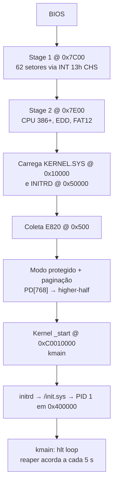

# Visão geral do Sedge

## O que é o Sedge

Sedge é um **sistema operacional hobby** para x86 (i686), escrito em C11 e NASM, com bootloader próprio, kernel em *higher-half*, multitarefa preemptiva em nível de usuário, syscalls por `int 0x80`, IPC por mailboxes e um VFS em construção. A versão atual do `Makefile` é **0.26.2** (25/11/2026). O projeto é distribuído sob a [licença MIT](../LICENSE) e sua documentação e código são escritos em português desde 22/10/2026.

| Característica | Valor |
|---|---|
| Arquitetura alvo | i686 (`-m32`), CPU 386+ |
| Boot | BIOS, setor de boot próprio (sem Multiboot) |
| Imagem | FAT12 de 1,44 MiB (`Sedge_i686-0.26.2_debug.img`) |
| Kernel | ELF32 convertido em binário, VMA `0xC0010000` |
| Paginação | 4 KiB, diretório recursivo, offset `0xC0000000` |
| Escalonamento | round-robin por tick de 10 ms (100 Hz) |
| Espaço de usuário | `init.sys` em `0x400000`, pilha em `0xBFFFF000`, ring 3 |
| Saída | VGA 80×25 (`0xC00B8000`) e serial COM1 @ 9600 |

## Fluxo de inicialização (alto nível)



## Mapa de memória

### Físico (visão do bootloader)

| Endereço | Conteúdo |
|---|---|
| `0x0000:0x7C00` | setor de boot e pilha do bootloader |
| `0x0500` / `0x0502` | contador/tabela E820 (24 bytes por entrada) e buffer FAT |
| `0x7E00` | stage2 (62 setores, até `0xF9FF`) |
| `0x10000` | `KERNEL.SYS` (limite `< 0x90000`) |
| `0x50000` | `INITRD` (limite `< 0x90000`) |

### Virtual (visão do kernel)

| Endereço | Conteúdo |
|---|---|
| `0xC0000500` | mapa E820 (`E820_ADDRESS`) |
| `0xC0010000` | início do kernel (`__kernel_start`) |
| `0xC0050000` | initrd (`initrd_loc`) |
| `0xC00B8000` | buffer de texto VGA (físico `0xB8000`) |
| `0x400000` | imagem do processo de usuário (`init`) |
| `0xBFF78000`–`0xBFFFF000` | pilhas de usuário (8 slots × 64 KiB + guard page) |
| `0xE0000000` | heap do kernel (24 páginas iniciais) |
| `0xFFC00000` | janela de auto-mapeamento do diretório de páginas |

## Componentes

| Subsistema | Documento | Resumo |
|---|---|---|
| Bootloader de 2 estágios, FAT12, E820 | [bootloader.md](bootloader.md) | BIOS → modo protegido → kernel |
| Sistema de build, imagem, QEMU/GDB | [build.md](build.md) | Makefiles, `mkfs.fat`, `mcopy` |
| Estrutura do kernel e sequência de boot | [kernel.md](kernel.md) | `kmain()` e inicialização na ordem |
| Camada i686 (entry, GDT, IDT, TSS, exceções) | [arquitetura-i686.md](arquitetura-i686.md) | interface com a CPU |
| Interrupções, PIC e PIT | [interrupcoes.md](interrupcoes.md) | IRQ0, timer, EOI |
| PMM, VMM e heap | [memoria.md](memoria.md) | bitmap, paginação, first-fit |
| Escalonador, processos e threads | [escalonador.md](escalonador.md) | round-robin, CR3, pilhas, reaper |
| Syscalls | [syscalls.md](syscalls.md) | `int 0x80`, convenção de registradores |
| IPC | [ipc.md](ipc.md) | mailbox, ring buffer, bloqueio |
| VFS | [vfs.md](vfs.md) | volumes, handles, callbacks (em construção) |
| Initrd e programa `init` | [initrd.md](initrd.md) | formato da imagem, PID 1 |
| Biblioteca comum e tipos | [biblioteca.md](biblioteca.md) | string, queue, bitmap, `vsnprintf` |
| Saída e depuração | [saida-e-debug.md](saida-e-debug.md) | `printk`, VGA, serial |
| Estado atual, pendências e histórico | [estado-atual.md](estado-atual.md) | bugs, TODO, versões |
| Termos e conceitos | [glossario.md](glossario.md) | referência rápida |

## Modelo de execução

- **Anel 0 (kernel):** GDT com `CS=0x08`, `DS/SS=0x10`; uma pilha estática de 4 KiB em `_start`, mais 4 KiB por thread no heap quando escalonada.
- **Anel 3 (usuário):** `CS=0x1B`, `DS/ES/FS/GS/SS=0x23`; imagem em `0x400000`, pilha de 64 KiB por thread. A transição é feita por `iret` a partir de um frame sintético.
- **Processo:** CR3 próprio (clonado do kernel), até 8 threads, mailbox de IPC, lista dupla de processos.
- **Thread:** estado (`RUNNING`, `READY`, `SLEEPING`, `BLOCKED`, `ZOMBIE`, `FREE`), ponteiro para frame salvo em `sp0`, fila de origem no nó `queue_node_t`.
- **Chamadas ao kernel:** `int 0x80` (syscalls) e `int 0x81` (yield), ambos com DPL 3.

A saída de todas as mensagens do kernel é duplicada entre o terminal VGA e a serial COM1, o que permite acompanhar o boot com `make qemu` e pelo arquivo `qemu.log`.

## Estrutura de diretórios

```text
Sedge/
├── bootloader/          stage1 e stage2 em NASM + Makefiles
├── include/             headers compartilhados (kernel, lib e usuário)
│   └── arch/i686/       syscall.h da API de usuário
├── kernel/
│   ├── include/         headers internos (sched, drivers, VFS, IPC...)
│   └── src/
│       ├── arch/i686/   entry, GDT, IDT, TSS, PMM, VMM, E820, syscalls
│       └── sched/       escalonador, processos e threads
├── lib/src/             biblioteca comum (libglobal)
├── initrd/
│   ├── make-initrd      gerador Python da imagem
│   └── init/            programa de usuário `init`
├── Makefile             build raiz, imagem e alvos QEMU
├── CHANGELOG.md         histórico de versões
├── TODO.md / IDEAS.md   pendências e ideias
└── docs/                esta documentação
```

## Estado do projeto

A base do sistema funciona de ponta a ponta: o bootloader carrega o kernel e o initrd, o kernel inicializa memória e interrupções, cria o PID 0 com a thread reaper e o PID 1 com `/init.sys`, que termina com status 42. VFS e RAMFS ainda estão em desenvolvimento, `sys_map`/`sys_unmap` são stubs, não há teclado nem page fault com demand paging, e a validação de ponteiros de usuário está pendente. A lista completa está em [estado-atual.md](estado-atual.md).
